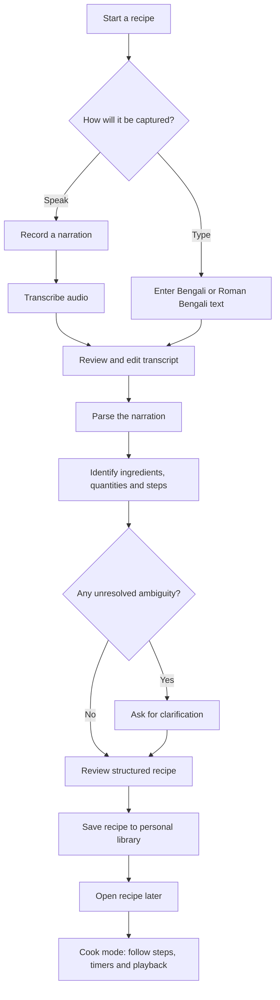
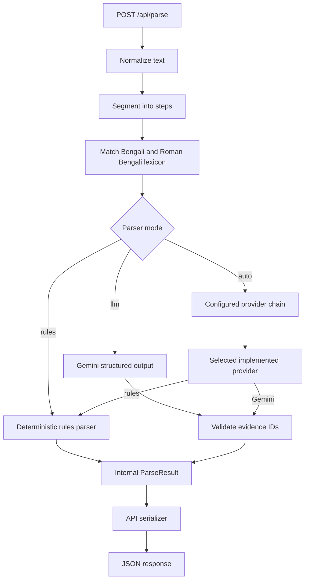
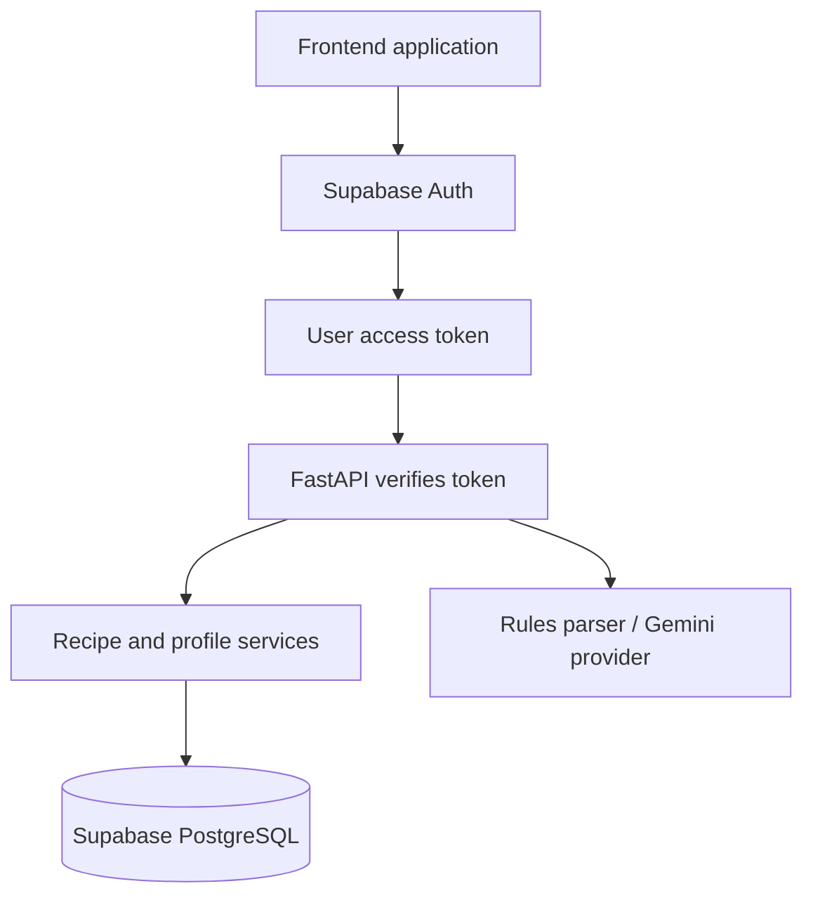

# Thakuma's Recipe · ঠাকুমার রান্না

> **Preserve the recipes we grew up with — in the words they were taught.**

Thakuma's Recipe is a Bengali home-cooking project that turns family recipe narrations into structured, searchable cooking instructions without pretending that every traditional measurement has an exact modern equivalent.

A cook might say:

> “এক মুঠো চাল, এক চিমটি নুন, আর জলটা যেমন লাগে।”  
> *One handful of rice, a pinch of salt, and as much water as needed.*

Those instructions are meaningful to the person who learned them. Our goal is to preserve that meaning, make the recipe easier to follow, and gradually build a way to understand each cook's own measurements.

---

## Contents

- [Why we're building this](#why-were-building-this)
- [Product principles](#product-principles)
- [User journey](#user-journey)
- [How the system works](#how-the-system-works)
- [What is implemented today](#what-is-implemented-today)
- [Technology](#technology)
- [Run the backend locally](#run-the-backend-locally)
- [API quick start](#api-quick-start)
- [Project structure](#project-structure)
- [What's next](#whats-next)
- [Privacy and data ownership](#privacy-and-data-ownership)
- [Team](#team)
- [Project documentation](#project-documentation)

---

## Why we're building this

Many family recipes are not written as formal ingredient lists. They are passed down through conversation, observation and repetition:

- “এক মুঠো চাল” — a handful of rice.
- “এক চিমটি নুন” — a pinch of salt.
- “অল্প অল্প করে জল দেবে” — add water gradually.
- “স্বাদমতো মশলা” — spices to taste.
- “যতক্ষণ না কষবে” — cook until the mixture is properly reduced.

A conventional recipe app often expects fixed quantities, standard units and serving counts. That can erase the cook's original method or introduce false precision.

Thakuma's Recipe is being designed around a different idea: **preserve what was said first, structure only what the evidence supports, and make uncertainty visible instead of guessing.**

## Product principles

### 1. Preserve the original narration

The original Bengali or Roman Bengali transcript is the source of truth. Parsed steps and quantities should retain their original wording and point back to the exact source spans.

### 2. Do not invent precision

A vague measure is not automatically a number. “অল্প”, “পরিমাণমতো” and “স্বাদমতো” must remain vague or taste-based unless there is supporting information.

### 3. A traditional measure belongs to a person and an ingredient

A handful is not a universal unit. One person's handful of uncooked rice may differ from another person's, and the same hand may hold different amounts of different ingredients. Future calibration is intended to record those differences rather than apply one global conversion.

### 4. Ask when the meaning is ambiguous

A plain “চামচ” does not tell us whether the cook means a teaspoon or tablespoon. An uncalibrated “কাপ” may mean a tea cup, measuring cup or personal cup. The system should ask rather than silently choose.

### 5. Separate the recipe from its yield

Knowing that a recipe uses one handful of rice does not tell us how many people it serves. Ingredient quantities, personal measure calibration and final recipe yield are separate pieces of information.

---

## User journey

The intended product journey is designed around four main stages: **Capture → Review → Recipe → Cook**.



### 1. Capture

A family cook can narrate a recipe, or the user can type/paste a transcript manually. Manual text is an important fallback: the recipe workflow should not depend on a live speech service being available.

### 2. Review

The transcript is shown before parsing so the user can correct names, quantities or recognition mistakes. The edited transcript—not an unseen original audio guess—should be the text sent to the parser.

### 3. Parse and clarify

The parser identifies ingredients, quantities, durations and ordered cooking steps. It distinguishes exact values, explicit ranges, vague phrases, taste-based instructions and unresolved measures. Ambiguous spoon and cup measurements can produce clarification requests.

### 4. Save and revisit

The planned account-based library will let a signed-in user save recipes, find them later, open them on another visit and retain previous recipe versions. This persistence flow is part of the target product; it is not yet represented as a completed feature in the current backend status below.

### 5. Cook

The longer-term cook experience is designed for one-step-at-a-time use, with visible progress, timers and optional spoken playback. A user should still be able to cook using the visible instructions if speech playback or microphone access is unavailable.

---

## How the system works

### Current backend flow

The implemented backend currently focuses on turning submitted text into a provenance-preserving parse result.



The rules parser is deterministic and offline. The Gemini parser is constrained to select evidence IDs generated from the local lexicon. The backend validates those IDs and constructs names, values and source spans from its own verified evidence rather than trusting model-generated wording or offsets.

### Planned account and persistence architecture

The selected direction for multi-user storage is **Supabase Auth + Supabase PostgreSQL**, with FastAPI remaining the application backend.



The intended ownership model separates three concepts:

- **Account user:** signs in and owns a personal recipe library.
- **Cook or narrator:** the family member who prepared or narrated a recipe; they do not necessarily need an account.
- **Measurement profile:** the person whose traditional measures may be calibrated in a future stage.

Supabase authentication, database migrations, ownership policies and protected recipe routes are planned work. They should not be mistaken for currently implemented functionality.

---

## What is implemented today

The following status is based on the completed backend milestones reported by the team.

| Area | Current status |
|---|---|
| FastAPI application and health endpoint | Implemented |
| Bengali/Roman Bengali normalization | Implemented |
| Recipe step segmentation with source spans | Implemented |
| Ingredient, measure, number and duration lexicon | Implemented |
| Deterministic rules parser | Implemented |
| Parse API and response serialization | Implemented |
| Gemini provider integration | Implemented; live manual smoke test still pending |
| Structured-output evidence validation | Implemented |
| Offline automated test suite | 322 tests passing at the M-10 checkpoint |
| Supabase Auth and user accounts | Planned; not implemented yet |
| Supabase PostgreSQL persistence | Planned; not implemented yet |
| Save/list/open recipe endpoints | Planned; not implemented yet |
| Recipe clarification/resolve endpoint | Not implemented yet |
| Personal hand-measure calibration | Not implemented yet |
| Gram/ml range estimation and serving scaling | Not implemented yet |
| Gnani live speech-to-text / text-to-speech | Not claimed as verified here |
| Full cook mode and saved-recipe library UI | Planned/in progress; verify current frontend branch |

**Important:** “Gemini provider integration implemented” means the provider wrapper, structured response schema, evidence validation and offline tests exist. The live Gemini smoke test was not run at the M-10 checkpoint because a live API key was unavailable. Do not describe live model quality as verified until that test is completed.

---

## Technology

| Layer | Technology | Responsibility |
|---|---|---|
| Backend API | Python, FastAPI, Pydantic | Request validation, API routes and response contracts |
| Text processing | Python standard library | Normalization, segmentation and deterministic matching |
| Recipe parsing | Rules parser + Gemini provider | Structured extraction from Bengali/Roman Bengali narration |
| LLM integration | Google Gen AI SDK | Gemini structured-output request |
| Authentication (planned) | Supabase Auth | Registration, login and session identity |
| Database (planned) | Supabase PostgreSQL | User-owned recipes, versions and future profiles |
| Frontend | Project frontend | Capture, review, recipe library and cook experience |
| Testing | pytest, Ruff | Offline regression tests and code-quality checks |

### Parsing modes

`POST /api/parse` accepts `text` and a parser `mode`:

| Mode | Behavior |
|---|---|
| `rules` | Runs the deterministic parser locally; no external API request. |
| `llm` | Explicitly selects Gemini. It does not silently fall back to rules. |
| `auto` | Uses the first implemented provider in the configured `LLM_CHAIN`. |

The default model configured for Gemini is `gemini-3.5-flash-lite`. The model can be overridden through configuration.

### Important extraction safeguards

- The model selects request-local evidence IDs; it does not provide canonical labels, source wording, values or offsets.
- Unknown evidence IDs, invalid categories, cross-segment references and duplicate references are rejected.
- Fuzzy suggestions are not used as confirmed matches.
- `মুইঠা` in চিতল মাছের মুইঠা is not treated as the traditional handful measure `মুঠো`.
- Explicit ranges remain ranges; vague and taste-based quantities remain non-numeric.
- Durations are kept separate from ingredient quantities.

---

## Run the backend locally

### Requirements

- Python installed on your machine.
- Git, if you are cloning the repository.
- A Gemini API key only if you intend to test `mode="llm"` or configure Gemini first in `LLM_CHAIN`.

### 1. Clone the repository

```bash
git clone <repository-url>
cd <repository-folder>
```

Replace the placeholders with the repository URL and directory name used by the team.

### 2. Create and activate a virtual environment

**Windows PowerShell:**

```powershell
python -m venv .venv
.venv\Scripts\Activate.ps1
```

**macOS / Linux:**

```bash
python3 -m venv .venv
source .venv/bin/activate
```

### 3. Install dependencies

```bash
python -m pip install -r requirements.txt
```

### 4. Configure environment variables

Copy `.env.example` to `.env` and fill in only the values needed for the mode you intend to use.

**Windows PowerShell:**

```powershell
Copy-Item .env.example .env
```

**macOS / Linux:**

```bash
cp .env.example .env
```

For an offline rules-only setup, configure the provider chain to use rules, for example:

```env
LLM_CHAIN=rules
```

For an explicit Gemini request, configure:

```env
GEMINI_API_KEY=your_gemini_api_key
GEMINI_MODEL=gemini-3.5-flash-lite
```

Never commit `.env`, API keys or other secrets.

### 5. Start the API

```bash
uvicorn backend.app.main:app --reload
```

The local API is available at `http://127.0.0.1:8000`.

Useful endpoints:

- Health: `http://127.0.0.1:8000/api/health`
- Interactive API documentation: `http://127.0.0.1:8000/docs`

The health endpoint reports application/database/provider status separately. An application process being up does not mean every external provider is available.

---

## API quick start

### Parse a Bengali recipe using the offline rules parser

```bash
curl -X POST "http://127.0.0.1:8000/api/parse" \
  -H "Content-Type: application/json" \
  -d '{
    "text": "এক চামচ তেল দাও। তারপর এক মুঠো চাল আর এক চিমটি নুন দাও, স্বাদমতো নুন। দশ মিনিট ঢিমে আঁচে রান্না করো।",
    "mode": "rules"
  }'
```

### Parse using Gemini

```bash
curl -X POST "http://127.0.0.1:8000/api/parse" \
  -H "Content-Type: application/json" \
  -d '{
    "text": "এক মুঠো চাল, এক চিমটি নুন, আর জলটা যেমন লাগে।",
    "mode": "llm"
  }'
```

The second request requires a configured Gemini API key. It is an explicit provider request and will return a documented error if Gemini is unavailable; it will not silently switch to rules mode.

### Example response shape

The parse endpoint returns a `recipe` and `meta` object. A recipe contains ordered steps, quantities and durations. Quantity records preserve the original phrase, source span, parser source and quantity kind.

For the full current response contract, see [`docs/04_API.md`](docs/04_API.md) and the verified fixture at [`docs/fixtures/parse_result.sample.json`](docs/fixtures/parse_result.sample.json).

---

## Tests and code quality

Run the offline test suite:

```bash
pytest -q
```

Run Ruff:

```bash
ruff check .
```

The backend test suite is designed not to call external APIs. Gemini behavior is tested using injected fakes/mocks. Live Gemini checks must be run manually and reported separately from automated test results.

At the M-10 completion checkpoint, the reported result was **322 tests passing** and **Ruff clean**. Re-run the commands on the current branch for the latest result.

---

## Project structure

The following is the high-level backend and documentation layout; consult the repository for the exact current tree.

```text
.
├── backend/
│   ├── app/
│   │   ├── main.py              # FastAPI application
│   │   ├── config.py            # Environment-backed configuration
│   │   ├── models.py            # Public API models
│   │   ├── routers/             # API endpoints
│   │   ├── parse/               # Normalization, segmentation, lexicon and parsers
│   │   └── providers/           # Replaceable LLM provider integrations
│   └── tests/                   # Offline unit and API tests
├── docs/
│   ├── 01_PRODUCT.md
│   ├── 02_ARCHITECTURE.md
│   ├── 03_DATA_MODEL.md
│   ├── 04_API.md
│   ├── 05_PARSER_SPEC.md
│   ├── 11_PRIVACY_CONSENT.md
│   ├── 12_TASKS.md
│   └── fixtures/
├── frontend/                    # Frontend application
├── prototype_v0/                # Historical prototype; not the current architecture
├── contributions/               # Team contribution records
├── .env.example
├── requirements.txt
└── README.md
```

Some planned directories and features may not exist on the current branch yet. The parser/provider paths above reflect the reported backend implementation.

---

## What's next

The immediate backend direction is to complete the product journey rather than continue expanding the parser indefinitely.

### Next implementation priorities

1. **Supabase foundation:** configure the project, PostgreSQL schema, migrations and row-level security.
2. **Authentication:** use Supabase Auth for registration, login and sessions; verify access tokens in FastAPI.
3. **User-owned recipes:** associate each saved recipe with the authenticated account.
4. **Recipe persistence API:** implement save, list, open, version, update and delete operations.
5. **Frontend integration:** connect authentication, recipe saving and the user's personal recipe library.
6. **End-to-end verification:** sign in, parse, save, restart/reopen, retrieve and confirm another account cannot access the saved recipe.

The target is a reliable vertical slice: **sign in → capture → review → parse → save → reopen → cook**.

### Features intentionally outside the first persistence milestone

- Measurement calibration and weighing records.
- Recipe scaling and yield inference.
- Pantry recommendations and collections.
- OCR/photo-based recipe import.
- Realtime cook-mode WebSockets.
- Advanced family-tree and social features.

These should be added only after the main journey is working reliably.

---

## Privacy and data ownership

The planned multi-user architecture separates account identity from the family member who narrated or cooked a recipe.

When Supabase is implemented:

- Every saved recipe must have an authenticated owner.
- Users must only be able to access their own recipes and versions.
- The backend must derive ownership from a verified access token, not a client-supplied user ID.
- Database row-level security should enforce owner-scoped access.
- Privileged database credentials must remain server-side.
- Voice capture should require consent when recording another person, and audio retention must follow the project's privacy policy.

Until authentication and persistence are implemented, do not treat the current API as a production multi-user recipe library.

---

## Team

| Contributor | Primary areas |
|---|---|
| **Mrinmoy Chakraborty** | Backend, parser, API contracts and integrations |
| **Shritama** | Frontend, UX, evaluation and demo experience |

For task ownership, branch conventions and contribution records, see [`docs/12_TASKS.md`](docs/12_TASKS.md) and [`docs/14_CONTRIBUTIONS.md`](docs/14_CONTRIBUTIONS.md).

---

## Project documentation

| Document | What it covers |
|---|---|
| [`docs/00_CONTEXT.md`](docs/00_CONTEXT.md) | Challenge context, constraints and verified information |
| [`docs/01_PRODUCT.md`](docs/01_PRODUCT.md) | Product vision, features and priorities |
| [`docs/02_ARCHITECTURE.md`](docs/02_ARCHITECTURE.md) | System components and application architecture |
| [`docs/03_DATA_MODEL.md`](docs/03_DATA_MODEL.md) | Data entities and relationships |
| [`docs/04_API.md`](docs/04_API.md) | REST API contract and examples |
| [`docs/05_PARSER_SPEC.md`](docs/05_PARSER_SPEC.md) | Parsing pipeline, evidence, ambiguity and tests |
| [`docs/06_UNITS_REFERENCE.md`](docs/06_UNITS_REFERENCE.md) | Traditional measures and future range calculations |
| [`docs/07_GNANI_INTEGRATION.md`](docs/07_GNANI_INTEGRATION.md) | Speech service integration notes and verification |
| [`docs/08_LLM_PROVIDERS.md`](docs/08_LLM_PROVIDERS.md) | LLM provider design and configuration |
| [`docs/09_UI_UX.md`](docs/09_UI_UX.md) | User experience and visual system |
| [`docs/10_EVAL_PLAN.md`](docs/10_EVAL_PLAN.md) | Evaluation methodology and limitations |
| [`docs/11_PRIVACY_CONSENT.md`](docs/11_PRIVACY_CONSENT.md) | Consent and data handling |
| [`docs/12_TASKS.md`](docs/12_TASKS.md) | Task board, ownership and delivery plan |
| [`docs/13_DEMO_AND_POST.md`](docs/13_DEMO_AND_POST.md) | Demo and submission materials |
| [`docs/14_CONTRIBUTIONS.md`](docs/14_CONTRIBUTIONS.md) | Contribution tracking and Git workflow |

---

**Thakuma's Recipe is being built to preserve not just what a recipe contains, but how it was taught.**
