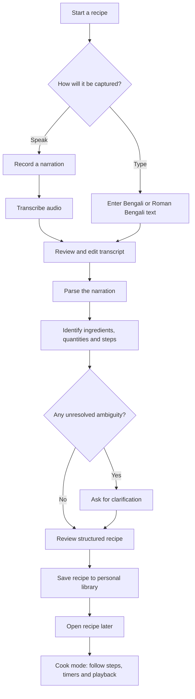
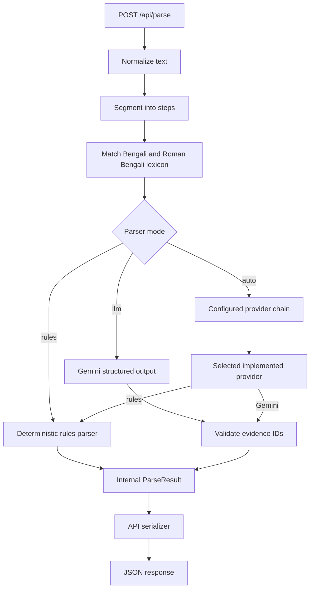
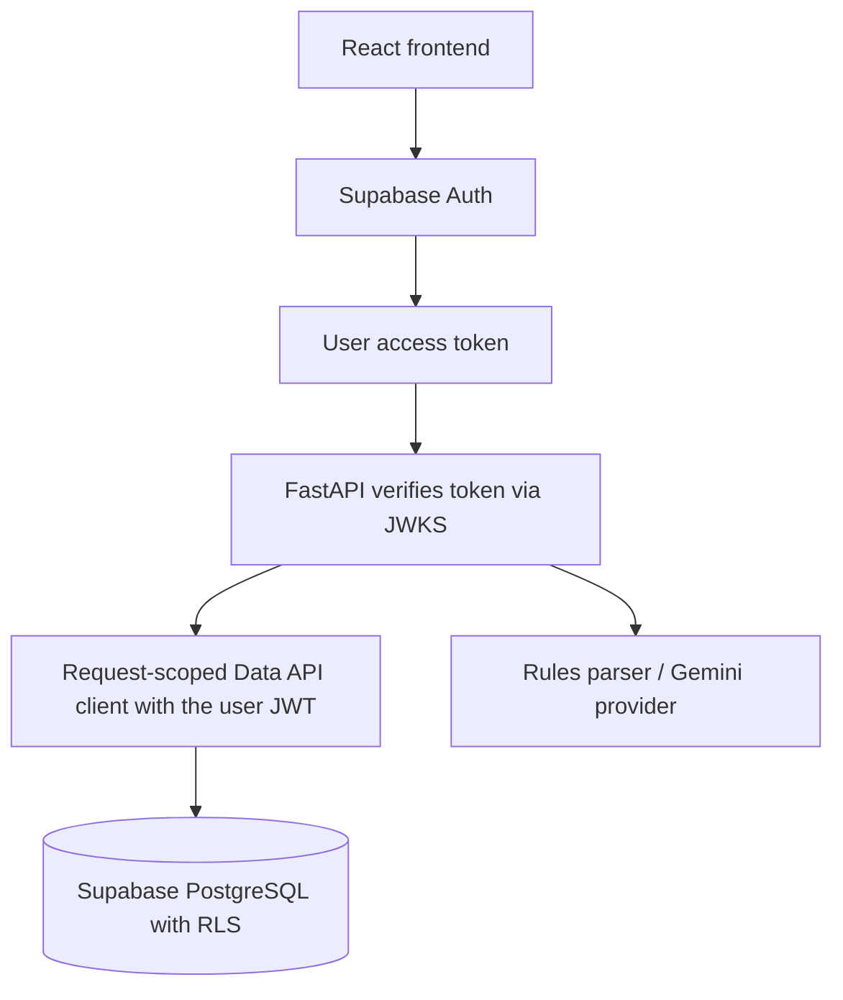

# Thakuma's Recipe · ঠাকুমার রান্না

> **Preserve the recipes we grew up with — in the words they were taught.**

Thakuma's Recipe is a Bengali home-cooking project that turns family recipe narrations into structured, searchable cooking instructions without pretending that every traditional measurement has an exact modern equivalent.

A cook might say:

> “এক মুঠো চাল, এক চিমটি নুন, আর জলটা যেমন লাগে।”  
> *One handful of rice, a pinch of salt, and as much water as needed.*

Those instructions are meaningful to the person who learned them. Our goal is to preserve that meaning, make the recipe easier to follow, and gradually build a way to understand each cook's own measurements.

---

## Contents

- [Why we're building this](#why-were-building-this)
- [Product principles](#product-principles)
- [User journey](#user-journey)
- [How the system works](#how-the-system-works)
- [What is implemented today](#what-is-implemented-today)
- [Technology](#technology)
- [Run the backend locally](#run-the-backend-locally)
- [Run the frontend locally](#run-the-frontend-locally)
- [Supabase setup](#supabase-setup)
- [Manual two-user verification](#manual-two-user-verification)
- [API quick start](#api-quick-start)
- [Project structure](#project-structure)
- [What's next](#whats-next)
- [Privacy and data ownership](#privacy-and-data-ownership)
- [Team](#team)
- [Project documentation](#project-documentation)

---

## Why we're building this

Many family recipes are not written as formal ingredient lists. They are passed down through conversation, observation and repetition:

- “এক মুঠো চাল” — a handful of rice.
- “এক চিমটি নুন” — a pinch of salt.
- “অল্প অল্প করে জল দেবে” — add water gradually.
- “স্বাদমতো মশলা” — spices to taste.
- “যতক্ষণ না কষবে” — cook until the mixture is properly reduced.

A conventional recipe app often expects fixed quantities, standard units and serving counts. That can erase the cook's original method or introduce false precision.

Thakuma's Recipe is being designed around a different idea: **preserve what was said first, structure only what the evidence supports, and make uncertainty visible instead of guessing.**

## Product principles

### 1. Preserve the original narration

The original Bengali or Roman Bengali transcript is the source of truth. Parsed steps and quantities should retain their original wording and point back to the exact source spans.

### 2. Do not invent precision

A vague measure is not automatically a number. “অল্প”, “পরিমাণমতো” and “স্বাদমতো” must remain vague or taste-based unless there is supporting information.

### 3. A traditional measure belongs to a person and an ingredient

A handful is not a universal unit. One person's handful of uncooked rice may differ from another person's, and the same hand may hold different amounts of different ingredients. Future calibration is intended to record those differences rather than apply one global conversion.

### 4. Ask when the meaning is ambiguous

A plain “চামচ” does not tell us whether the cook means a teaspoon or tablespoon. An uncalibrated “কাপ” may mean a tea cup, measuring cup or personal cup. The system should ask rather than silently choose.

### 5. Separate the recipe from its yield

Knowing that a recipe uses one handful of rice does not tell us how many people it serves. Ingredient quantities, personal measure calibration and final recipe yield are separate pieces of information.

---

## User journey

The intended product journey is designed around four main stages: **Capture → Review → Recipe → Cook**.



### 1. Capture

A family cook can narrate a recipe, or the user can type/paste a transcript manually. Manual text is an important fallback: the recipe workflow should not depend on a live speech service being available.

### 2. Review

The transcript is shown before parsing so the user can correct names, quantities or recognition mistakes. The edited transcript—not an unseen original audio guess—should be the text sent to the parser.

### 3. Parse and clarify

The parser identifies ingredients, quantities, durations and ordered cooking steps. It distinguishes exact values, explicit ranges, vague phrases, taste-based instructions and unresolved measures. Ambiguous spoon and cup measurements can produce clarification requests.

### 4. Save and revisit

A signed-in user can save a parsed recipe into their own library, list and open their recipes, and edit one to create a new immutable version. Supabase Auth handles sign-in and Supabase PostgreSQL stores the recipes; ownership is enforced by the backend and by database row-level security. The minimal React frontend in `frontend/` wires this journey (auth, parse, save, library, version, delete). See [Run the frontend locally](#run-the-frontend-locally) and [Manual two-user verification](#manual-two-user-verification).

### 5. Cook

The longer-term cook experience is designed for one-step-at-a-time use, with visible progress, timers and optional spoken playback. A user should still be able to cook using the visible instructions if speech playback or microphone access is unavailable.

---

## How the system works

### Current backend flow

The implemented backend currently focuses on turning submitted text into a provenance-preserving parse result.



The rules parser is deterministic and offline. The Gemini parser is constrained to select evidence IDs generated from the local lexicon. The backend validates those IDs and constructs names, values and source spans from its own verified evidence rather than trusting model-generated wording or offsets.

### Account and persistence architecture

Multi-user storage is **Supabase Auth + Supabase PostgreSQL**, with FastAPI remaining the application backend.



- The frontend uses the Supabase Auth client only for sign-in/sign-out and session/token handling. Every recipe read or write goes through FastAPI with `Authorization: Bearer <access_token>`; the frontend never talks to the database directly.
- FastAPI verifies the token before any work (signature via JWKS for asymmetric projects, or Supabase Auth's `/user` endpoint for legacy HS256 projects, plus `exp`, `iss` and `aud`). Identity is the verified `sub`; a client-supplied user id is never trusted.
- The backend builds a **per-request** Supabase Data API client carrying the user's token. There is no shared mutable client and no service-role key, so PostgreSQL row-level security evaluates the real authenticated user.
- Ownership uses three separate concepts:

  - **Account user:** signs in and owns a personal recipe library.
  - **Cook or narrator:** the family member who prepared or narrated a recipe; they do not necessarily need an account (person management is postponed).
  - **Measurement profile:** the person whose traditional measures may be calibrated in a future stage (postponed).

The schema is three tables (`profiles`, `recipes`, `recipe_versions`) created by `supabase/migrations/0001_initial_schema.sql`; see [Supabase setup](#supabase-setup) and [`docs/03_DATA_MODEL.md`](docs/03_DATA_MODEL.md).

---

## What is implemented today

The following status is based on the completed backend milestones reported by the team.

| Area | Current status |
|---|---|
| FastAPI application and health endpoint | Implemented |
| Bengali/Roman Bengali normalization | Implemented |
| Recipe step segmentation with source spans | Implemented |
| Ingredient, measure, number and duration lexicon | Implemented |
| Deterministic rules parser | Implemented |
| Parse API and response serialization | Implemented |
| Gemini provider integration | Implemented; live manual smoke test still pending |
| Structured-output evidence validation | Implemented |
| Supabase Auth and user accounts | Implemented (Supabase Auth; access tokens verified by FastAPI) |
| Supabase PostgreSQL persistence | Implemented (migration + data API; live project not exercised by the test suite) |
| Recipe save / list / open / version / delete endpoints | Implemented and tested offline |
| `/api/me` authenticated profile endpoint | Implemented |
| PostgreSQL row-level security migration | Implemented (`supabase/migrations/0001_initial_schema.sql`); real two-user behaviour must be verified manually |
| Frontend auth + personal library | Implemented as a minimal React/Vite app (`frontend/`); visual/UX polish remains |
| Offline automated test suite | 427 backend tests passing; `ruff check .` clean; `npm run build` for the frontend |
| Recipe clarification/resolve endpoint | Not implemented yet |
| Personal hand-measure calibration | Not implemented yet |
| Gram/ml range estimation and serving scaling | Not implemented yet |
| Gnani live speech-to-text / text-to-speech | Not claimed as verified here |
| Full cook mode | Not implemented yet |

**Important:** “Gemini provider integration implemented” means the provider wrapper, structured response schema, evidence validation and offline tests exist. The live Gemini smoke test was not run because a live API key was unavailable, and the Supabase tests use injected fakes — they do not prove a live project works. Run the [manual two-user verification](#manual-two-user-verification) before claiming live persistence.

---

## Technology

| Layer | Technology | Responsibility |
|---|---|---|
| Backend API | Python, FastAPI, Pydantic | Request validation, API routes and response contracts |
| Text processing | Python standard library | Normalization, segmentation and deterministic matching |
| Recipe parsing | Rules parser + Gemini provider | Structured extraction from Bengali/Roman Bengali narration |
| LLM integration | Google Gen AI SDK | Gemini structured-output request |
| Authentication | Supabase Auth (JWKS/PyJWT verification in FastAPI) | Registration, login, sessions and verified access tokens |
| Database | Supabase PostgreSQL Data API (`postgrest`) | Owner-scoped recipes, versions and profiles, with RLS |
| Frontend | React + Vite + `@supabase/supabase-js` | Auth screens, parse/save, personal library and versioning |
| Testing | pytest, Ruff, `vite build` | Offline backend regression tests and a frontend production build |

### Parsing modes

`POST /api/parse` accepts `text` and a parser `mode`:

| Mode | Behavior |
|---|---|
| `rules` | Runs the deterministic parser locally; no external API request. |
| `llm` | Explicitly selects Gemini. It does not silently fall back to rules. |
| `auto` | Uses the first implemented provider in the configured `LLM_CHAIN`. |

The default model configured for Gemini is `gemini-3.5-flash-lite`. The model can be overridden through configuration.

### Important extraction safeguards

- The model selects request-local evidence IDs; it does not provide canonical labels, source wording, values or offsets.
- Unknown evidence IDs, invalid categories, cross-segment references and duplicate references are rejected.
- Fuzzy suggestions are not used as confirmed matches.
- `মুইঠা` in চিতল মাছের মুইঠা is not treated as the traditional handful measure `মুঠো`.
- Explicit ranges remain ranges; vague and taste-based quantities remain non-numeric.
- Durations are kept separate from ingredient quantities.

---

## Run the backend locally

### Requirements

- Python installed on your machine.
- Git, if you are cloning the repository.
- Node.js 20+ for the React frontend (optional; only needed for the UI).
- A Supabase project (project URL + publishable key) for accounts and storage. The backend still starts without one and serves `/api/parse` and `/api/health`; only the recipe routes need Supabase.
- A Gemini API key only if you intend to test `mode="llm"` or configure Gemini first in `LLM_CHAIN`.

### 1. Clone the repository

```bash
git clone <repository-url>
cd <repository-folder>
```

Replace the placeholders with the repository URL and directory name used by the team.

### 2. Create and activate a virtual environment

**Windows PowerShell:**

```powershell
python -m venv .venv
.venv\Scripts\Activate.ps1
```

**macOS / Linux:**

```bash
python3 -m venv .venv
source .venv/bin/activate
```

### 3. Install dependencies

```bash
python -m pip install -r requirements.txt
```

### 4. Configure environment variables

Copy `.env.example` to `.env` and fill in only the values needed for the mode you intend to use.

**Windows PowerShell:**

```powershell
Copy-Item .env.example .env
```

**macOS / Linux:**

```bash
cp .env.example .env
```

For an offline rules-only setup, configure the provider chain to use rules, for example:

```env
LLM_CHAIN=rules
```

For an explicit Gemini request, configure:

```env
GEMINI_API_KEY=your_gemini_api_key
GEMINI_MODEL=gemini-3.5-flash-lite
```

For accounts and recipe storage, configure the Supabase project (see [Supabase setup](#supabase-setup)):

```env
SUPABASE_URL=https://<project-ref>.supabase.co
SUPABASE_PUBLISHABLE_KEY=<publishable-key>
FRONTEND_ORIGINS=http://localhost:5173
```

`SUPABASE_PUBLISHABLE_KEY` is public project metadata, not a password and not a JWT signing key. No database password, connection string or service-role key is used by this backend. Never commit `.env`, API keys or other secrets.

### 5. Start the API

```bash
uvicorn backend.app.main:app --reload
```

The local API is available at `http://127.0.0.1:8000`.

Useful endpoints:

- Health: `http://127.0.0.1:8000/api/health`
- Interactive API documentation: `http://127.0.0.1:8000/docs`

The health endpoint reports application/database/provider status separately. An application process being up does not mean every external provider is available. The `db` block is `not_configured` without Supabase, `unverified` when configured but not probed, and `ok`/`unavailable` only after the running app's probe.

---

## Run the frontend locally

```bash
cd frontend
npm install
cp .env.example .env      # Windows PowerShell: Copy-Item .env.example .env
```

Set these values in `frontend/.env` (never commit it):

```env
VITE_SUPABASE_URL=https://<project-ref>.supabase.co
VITE_SUPABASE_PUBLISHABLE_KEY=<publishable-key>
VITE_API_BASE_URL=http://localhost:8000
```

Then:

```bash
npm run dev
```

Vite serves the app at `http://localhost:5173`. The backend must allow that origin (default `FRONTEND_ORIGINS=http://localhost:5173`). Build the production bundle with `npm run build` (output in `frontend/dist/`, which is ignored).

The frontend uses Supabase **only** for Auth (sign-up, sign-in, Google when enabled, logout, session/token refresh). Every recipe read/write goes to FastAPI with `Authorization: Bearer <access_token>`; it never writes to the database directly.

---

## Supabase setup

1. Create or select a project at <https://supabase.com>.
2. Enable the auth providers you need (Email/Password, and optionally Google). For Google, configure the provider in Supabase and add the app URL/redirect URLs.
3. Apply the migration: open **Dashboard → SQL Editor**, paste the whole of [`supabase/migrations/0001_initial_schema.sql`](supabase/migrations/0001_initial_schema.sql), and run it. This creates `profiles`, `recipes`, `recipe_versions`, the new-user profile trigger, RLS policies and the atomic RPCs. No Supabase CLI or Docker is required.
4. Configure environments:
   - backend `.env`: `SUPABASE_URL`, `SUPABASE_PUBLISHABLE_KEY`, `FRONTEND_ORIGINS`
   - `frontend/.env`: `VITE_SUPABASE_URL`, `VITE_SUPABASE_PUBLISHABLE_KEY`, `VITE_API_BASE_URL`
   - Use the same project URL and publishable key in both.
5. In Supabase Auth URL configuration, add `http://localhost:5173` (and your deployed origin) to the Site URL/Redirect URLs.
6. Restart the backend and start the frontend.

The publishable key is safe to ship to the browser. Never put a service-role key in a `VITE_` variable or any frontend bundle.

**What the migration enforces:** every recipe has a mandatory `owner_user_id`; RLS requires `auth.uid() = owner_user_id` for select/insert/update/delete; versions are readable/insertable only through an owned recipe and have no update/delete policy; deleting a recipe cascades to its versions; `add_recipe_version` locks the recipe row before computing the next version number.

---

## Manual two-user verification

This is the real Supabase check. The automated tests use injected fakes and do **not** prove live RLS behaviour. Record the actual date/project/result; do not claim a live pass that was not run.

1. Start the backend and frontend and open `http://localhost:5173`.
2. Register **User A** (email/password; confirm the email if the project requires it).
3. Enter a Bengali narration, parse it with the offline rules mode, give it a title, and save it. It should appear in the library.
4. Reload the page. The session should persist and the recipe should still be listed. Open it and verify the exact transcript and complete `ParseResult` JSON are returned.
5. Edit it. Version 2 should be created and version 1 must remain unchanged (check in the SQL Editor: `select version_number, original_transcript from recipe_versions where recipe_id = '...' order by version_number;`).
6. Log out, then register/sign in as **User B**.
7. User B's library must not list User A's recipe, and direct `GET`/`PUT`/`DELETE` on A's recipe id must return `404 NOT_FOUND`.
8. Sign back in as User A; the recipe must be intact. Delete it and confirm its versions are gone (`select count(*) from recipe_versions where recipe_id = '...';` returns 0).

Use two test accounts and non-sensitive sample recipes. Do not put real personal data in the repository or demo.

---

## API quick start

### Parse a Bengali recipe using the offline rules parser

```bash
curl -X POST "http://127.0.0.1:8000/api/parse" \
  -H "Content-Type: application/json" \
  -d '{
    "text": "এক চামচ তেল দাও। তারপর এক মুঠো চাল আর এক চিমটি নুন দাও, স্বাদমতো নুন। দশ মিনিট ঢিমে আঁচে রান্না করো।",
    "mode": "rules"
  }'
```

### Parse using Gemini

```bash
curl -X POST "http://127.0.0.1:8000/api/parse" \
  -H "Content-Type: application/json" \
  -d '{
    "text": "এক মুঠো চাল, এক চিমটি নুন, আর জলটা যেমন লাগে।",
    "mode": "llm"
  }'
```

The second request requires a configured Gemini API key. It is an explicit provider request and will return a documented error if Gemini is unavailable; it will not silently switch to rules mode.

### Example response shape

The parse endpoint returns a `recipe` and `meta` object. A recipe contains ordered steps, quantities and durations. Quantity records preserve the original phrase, source span, parser source and quantity kind.

For the full current response contract, see [`docs/04_API.md`](docs/04_API.md) and the verified fixture at [`docs/fixtures/parse_result.sample.json`](docs/fixtures/parse_result.sample.json).

---

## Tests and code quality

Run the offline test suite:

```bash
pytest -q
```

Run Ruff:

```bash
ruff check .
```

Build the frontend:

```bash
cd frontend
npm install
npm run build
```

The backend suite never calls Gemini or Supabase. Auth is tested with locally generated RSA keys and a mocked JWKS endpoint (plus a mocked legacy `/user` response); recipe tests use injected fakes. The migration test checks the SQL text (tables, cascades, RLS policies, atomic RPC) but does **not** prove live RLS. Live Gemini and live two-user Supabase checks must be run manually and reported separately.

Current result at the M-18–M-20 checkpoint: **427 backend tests passing**, **Ruff clean**, and the frontend production build succeeds. Re-run the commands on the current branch for the latest result.

---

## Project structure

The following is the high-level backend and documentation layout; consult the repository for the exact current tree.

```text
.
├── backend/
│   ├── app/
│   │   ├── main.py              # FastAPI application + CORS
│   │   ├── config.py            # Environment-backed configuration
│   │   ├── models.py            # Public API models
│   │   ├── auth/                # Supabase token verification + current-user deps
│   │   ├── db/                  # Per-request Data API client, repository, schemas
│   │   ├── routers/             # health, parse, recipes + /api/me
│   │   ├── parse/               # Normalization, segmentation, lexicon and parsers
│   │   └── providers/           # Replaceable LLM provider integrations
│   └── tests/                   # Offline auth, repository, API, migration tests
├── supabase/
│   └── migrations/
│       └── 0001_initial_schema.sql   # Tables, RLS policies, triggers, atomic RPCs
├── frontend/
│   ├── package.json             # React + Vite + @supabase/supabase-js
│   ├── .env.example
│   └── src/                     # Auth panel, recipe editor, library, versioning
├── docs/                        # Product, architecture, data model, API, tasks
├── prototype_v0/                # Historical prototype; not the current architecture
├── contributions/               # Team contribution records
├── .env.example
├── requirements.txt
└── README.md
```

---

## What's next

The immediate backend direction is to complete the product journey rather than continue expanding the parser indefinitely.

### Next implementation priorities

1. **Live Supabase verification:** run the [manual two-user verification](#manual-two-user-verification) on a real project and record the result. The automated suite uses fakes.
2. **Frontend completion:** capture/record flow, clarification cards and cook mode (tasks S-16..S-18). The current React app covers auth, parse, save, library, version and delete.
3. **Production hardening:** request limits, safe audit logging and monitoring around the Data API and Auth.
4. **Postponed features:** personal calibration, recipe scaling, pantry search and collections only after the main journey is verified.

The target remains a reliable vertical slice: **sign in → capture → review → parse → save → reopen → cook**.

### Features intentionally outside the first persistence milestone

- Measurement calibration and weighing records.
- Recipe scaling and yield inference.
- Pantry recommendations and collections.
- OCR/photo-based recipe import.
- Realtime cook-mode WebSockets.
- Advanced family-tree and social features.

These should be added only after the main journey is working reliably.

---

## Privacy and data ownership

The multi-user architecture separates account identity from the family member who narrated or cooked a recipe.

With Supabase implemented:

- Every saved recipe has an authenticated owner (`owner_user_id` is `NOT NULL`).
- Users can access only their own recipes and versions; the backend checks the owner and PostgreSQL RLS enforces `auth.uid()` independently.
- Ownership comes from the verified access token's `sub`, never from a client-supplied user id.
- The Data API client carries the user's own token per request. Ordinary recipe operations never use a service-role key, and no shared client can leak one user's token to another.
- The publishable key is public project metadata, but a service-role key must never appear in `VITE_` variables or a frontend bundle.
- Voice capture must require consent when recording another person, and audio retention must follow the project's privacy policy.

The automated tests prove the application logic and token verification with fakes; they do not prove live RLS. Run the [manual two-user verification](#manual-two-user-verification) before treating a deployed instance as a production multi-user library.

---

## Team

| Contributor | Primary areas |
|---|---|
| **Mrinmoy Chakraborty** | Backend, parser, API contracts and integrations |
| **Shritama** | Frontend, UX, evaluation and demo experience |

For task ownership, branch conventions and contribution records, see [`docs/12_TASKS.md`](docs/12_TASKS.md) and [`docs/14_CONTRIBUTIONS.md`](docs/14_CONTRIBUTIONS.md).

---

## Project documentation

| Document | What it covers |
|---|---|
| [`docs/00_CONTEXT.md`](docs/00_CONTEXT.md) | Challenge context, constraints and verified information |
| [`docs/01_PRODUCT.md`](docs/01_PRODUCT.md) | Product vision, features and priorities |
| [`docs/02_ARCHITECTURE.md`](docs/02_ARCHITECTURE.md) | System components and application architecture |
| [`docs/03_DATA_MODEL.md`](docs/03_DATA_MODEL.md) | Data entities and relationships |
| [`docs/04_API.md`](docs/04_API.md) | REST API contract and examples |
| [`docs/05_PARSER_SPEC.md`](docs/05_PARSER_SPEC.md) | Parsing pipeline, evidence, ambiguity and tests |
| [`docs/06_UNITS_REFERENCE.md`](docs/06_UNITS_REFERENCE.md) | Traditional measures and future range calculations |
| [`docs/07_GNANI_INTEGRATION.md`](docs/07_GNANI_INTEGRATION.md) | Speech service integration notes and verification |
| [`docs/08_LLM_PROVIDERS.md`](docs/08_LLM_PROVIDERS.md) | LLM provider design and configuration |
| [`docs/09_UI_UX.md`](docs/09_UI_UX.md) | User experience and visual system |
| [`docs/10_EVAL_PLAN.md`](docs/10_EVAL_PLAN.md) | Evaluation methodology and limitations |
| [`docs/11_PRIVACY_CONSENT.md`](docs/11_PRIVACY_CONSENT.md) | Consent and data handling |
| [`docs/12_TASKS.md`](docs/12_TASKS.md) | Task board, ownership and delivery plan |
| [`docs/13_DEMO_AND_POST.md`](docs/13_DEMO_AND_POST.md) | Demo and submission materials |
| [`docs/14_CONTRIBUTIONS.md`](docs/14_CONTRIBUTIONS.md) | Contribution tracking and Git workflow |

---

**Thakuma's Recipe is being built to preserve not just what a recipe contains, but how it was taught.**
