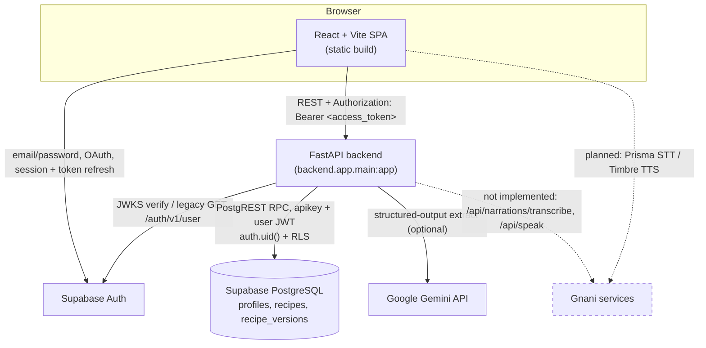

# Deployment Readiness Audit — Thakuma's Recipe

Status: audit only. No service was enabled, no credential generated, no migration applied,
no live external call made, and no application code changed. Every claim below is grounded
in a repository file, a command result, or is explicitly labelled unverified.

Audit date: 2026-11-08 · Branch: `mrinmoy` · Auditor: automated repository inspection.

---

## 1. Executive summary

The backend is **runnable but not deployable as-is**. It is a complete FastAPI service that
starts with zero credentials, serves `/api/health` and `/api/parse` (rules mode), and passes
its offline suite, but its account + persistence journey cannot work until a real Supabase
project exists, the SQL migration is applied, and the correct environment variables are set.

Verified locally during this audit:

- `pytest -q` → **427 passed, 2 warnings in 6.39s** (offline; no network).
- `ruff check .` → **All checks passed!**
- `cd frontend && npm run build` → **built in 1.45s** (`dist/` produced).
- Registered routes (`python -c ...`): `/api/health`, `/api/me`, `/api/parse`,
  `/api/recipes`, `/api/recipes/{recipe_id}` (+ `/docs`, `/openapi.json`, `/redoc`).
- No `.env`, `frontend/.env` or `backend/.env` file exists in the working tree.

Key findings:

1. **Supabase is the only mandatory external service.** Auth + PostgreSQL are implemented in
   code but no project exists and the migration is unapplied (`supabase/migrations/0001_initial_schema.sql`).
2. **Gemini is optional.** The provider is implemented (`backend/app/providers/gemini.py`) but not
   required for the core journey; the configured default model `gemini-3.5-flash-lite` is
   **unverified** against any account.
3. **Gnani is not implemented at all**, beyond three unused settings fields. No Prisma STT, no
   Timbre TTS, no audio route (`docs/07_GNANI_INTEGRATION.md` is a plan; the routes in
   `docs/02_ARCHITECTURE.md` do not exist in `backend/app`).
4. **No deployment manifest exists** (no `Dockerfile`, `render.yaml`, `vercel.json`, `Procfile`,
   `fly.toml`, `railway.json`, `.python-version`, or GitHub Actions workflow).
5. **All of the Supabase/Auth/DB/frontend work is uncommitted** on `mrinmoy`
   (`backend/app/auth/`, `backend/app/db/`, `backend/app/routers/recipes.py`, `frontend/`,
   `supabase/` are untracked; several files are modified).

**Verdict: not deployable yet.** Two things must happen first: create/configure the Supabase
project and commit the current work. Everything else is configuration or optional.

---

## 2. Current implementation inventory

Statuses: **Implemented** (connected), **Mocked**, **Partially implemented**,
**Configured but unverified**, **Verified live**, **Not implemented**, **Not applicable**.

| Component | Evidence | Status |
|---|---|---|
| FastAPI app factory, CORS, error envelope | `backend/app/main.py:37-93` | Implemented |
| Health check incl. honest DB probe | `backend/app/routers/health.py:119-155` | Implemented (probe unverified against a real project) |
| Rules parser + `POST /api/parse` | `backend/app/parse/*`, `backend/app/routers/parse.py` | Implemented |
| Gemini provider | `backend/app/providers/gemini.py`, `backend/app/parse/llm.py` | Implemented; **live call unverified** |
| Structured-output evidence validation | `backend/app/parse/llm.py:222-289` | Implemented |
| Supabase Auth token verification (JWKS + legacy HS256) | `backend/app/auth/verification.py` | Implemented; tested with locally generated RSA keys only |
| `GET /api/me` + protected routes | `backend/app/routers/recipes.py` | Implemented |
| Supabase PostgreSQL tables, RLS, RPCs | `supabase/migrations/0001_initial_schema.sql` | **Configured but unverified** (SQL exists; no project) |
| Per-request PostgREST client (user JWT) | `backend/app/db/client.py` | Implemented; tested with `httpx.MockTransport` |
| Recipe CRUD (create/list/get/version/delete) | `backend/app/db/repository.py`, `routers/recipes.py` | Implemented; tested with in-memory fakes |
| Frontend auth + library (React/Vite) | `frontend/src/**` | Implemented; build succeeds |
| CORS | `backend/app/main.py:59-65` | Configured for `http://localhost:5173` only |
| Audio transcription (Gnani Prisma) | — | **Not implemented** |
| TTS (Gnani Timbre) / `/api/speak` | — | **Not implemented** |
| `/api/narrations/transcribe`, cook mode, `/ws/cook` | — | **Not implemented** |
| Rate limiting / request-size limits | — | **Not implemented** |
| Service-role key usage | absent by design | Not applicable (deliberately excluded) |
| SQLite | absent (no dependency, no code) | Not applicable (Supabase is the DB) |

Note: `docs/02_ARCHITECTURE.md` and `docs/04_API.md` describe packages, routes and services
(`gnani/`, `units/`, `/api/speak`, `/ws/cook`, Ollama/Evon providers) that **do not exist in code**.
They are plans, not current state.

---

## 3. External services required

| Service | Needed now? | Why |
|---|---|---|
| **Supabase project (Auth + PostgreSQL + Data API + RLS)** | **Yes** | Accounts and all recipe persistence. Without it the frontend shows the config notice and `/api/recipes*` + `/api/me` return `503`. |
| **Google Gemini API** | **No** (optional) | Only for `mode="llm"` or Gemini first in `LLM_CHAIN`. The rules parser works fully offline. |
| **Gnani (Prisma / Timbre)** | **No** | No client code exists; the app runs without it. |

There is **no** service-role key, database password, or `SUPABASE_DB_URL` connection string in
the design — the backend uses the publishable key + the user's access token via PostgREST
(`backend/app/db/client.py:29-79`).

---

## 4. External services optional or unfinished

- **Gemini** — code complete, credentials absent, model name unverified. Enable only for the
  LLM demo path.
- **Gnani Prisma STT** — documented only (`docs/07_GNANI_INTEGRATION.md`). Not required for the
  current release; slated as P0 in `docs/12_TASKS.md` for the full demo, but not for the
  persistence milestone.
- **Gnani Timbre TTS / `/api/speak`** — not implemented (task M-21 in `docs/12_TASKS.md`).
- **Ollama and Evon/Kaggle providers** — referenced in `docs/08_LLM_PROVIDERS.md`; no code, no
  settings used by any provider beyond the unused `ollama_base_url`/`ollama_model`.
- **LLM cache / replay (`LLM_REPLAY_ONLY`)** — setting exists but no cache or replay code exists.

Do not enable these services for this release.

---

## 5. Environment variable matrix

All variables are currently **absent** (no `.env` files exist). Values shown in the "Default"
column come from `backend/app/config.py` and `frontend/src/*`.

### 5.1 Backend (Pydantic `Settings`, `backend/app/config.py`)

| Variable | Used by | Required? | Where to obtain | Secret? | Current status |
|---|---|---|---|---|---|
| `SUPABASE_URL` | `config.py:55`, auth `verification.py`, db client, health probe | **Yes** (auth + recipes) | Supabase → Project Settings → API → Project URL | No | Absent |
| `SUPABASE_PUBLISHABLE_KEY` | `config.py:56`, auth `verification.py:81`, db `client.py:71`, health probe | **Yes** (auth + recipes) | Supabase → Project Settings → API → publishable key | No (public metadata) | Absent |
| `SUPABASE_ANON_KEY` | `config.py:58` fallback for `supabase_key` | No (legacy fallback) | Supabase legacy anon key | No | Absent |
| `SUPABASE_JWT_AUDIENCE` | `config.py:59`, `verification.py:84` | No (default `authenticated`) | Supabase Auth settings | No | Default `authenticated` |
| `SUPABASE_JWKS_CACHE_SECONDS` | `config.py:60` | No (default `300`) | — | No | Default |
| `SUPABASE_REQUEST_TIMEOUT` | `config.py:61`, db + auth timeouts | No (default `10.0`) | — | No | Default |
| `FRONTEND_ORIGINS` | `config.py:64`, `main.py:61` CORS | **Yes, correct value required** | Your frontend URL(s), comma-separated | No | Default `http://localhost:5173` |
| `GEMINI_API_KEY` | `config.py:45`, `providers/gemini.py:144` | No (only for `llm`) | Google AI Studio → Get API key | **Yes** | Absent |
| `GEMINI_MODEL` | `config.py:46`, `providers/gemini.py:145` | No (default `gemini-3.5-flash-lite`) | Google AI model list | No | Default (unverified) |
| `LLM_CHAIN` | `config.py:44`, `routers/parse.py:59` | No (default `rules`) | e.g. `gemini,rules` | No | Default `rules` |
| `GNANI_API_KEY` | `config.py:36`, health only | No (no client exists) | Gnani dashboard | Yes | Absent |
| `GNANI_MOCK` | `config.py:37`, health only | No (default `1`) | — | No | Default |
| `GNANI_STT_MODEL` / `GNANI_TTS_MODEL` / `GNANI_VOICE` | `config.py:38-40` (declared, unused) | No | Gnani docs | No | Default |
| `OLLAMA_BASE_URL` / `OLLAMA_MODEL` | `config.py:47-48`, health only | No | — | No | Default |
| `LLM_REPLAY_ONLY` | `config.py:49` (declared, unused) | No | — | No | Default |
| `APP_NAME` / `API_PREFIX` | `config.py:32-33` | No | — | No | Defaults |
| `MOCK_FIXTURE_PATH` | `config.py:67` (declared, unused) | No | — | No | Default |

Notes:
- `EVON_BASE_URL` / `EVON_API_KEY` appear in old docs but are **not** in `Settings` and would be
  ignored (`extra="ignore"`). Do not configure them.
- Setting `GEMINI_API_KEY` does **not** by itself enable Gemini in `mode="auto"`; `auto` follows
  `LLM_CHAIN`, which defaults to `rules`.

### 5.2 Frontend (Vite, compile-time inlined)

| Variable | Used by | Required? | Where to obtain | Secret? | Current status |
|---|---|---|---|---|---|
| `VITE_SUPABASE_URL` | `frontend/src/supabase.js:3` | **Yes** (auth + library) | Supabase → Settings → API → Project URL | No | Absent |
| `VITE_SUPABASE_PUBLISHABLE_KEY` | `frontend/src/supabase.js:4` | **Yes** | Supabase → Settings → API → publishable key | No | Absent |
| `VITE_API_BASE_URL` | `frontend/src/api.js:1` | **Yes in production** (falls back to `http://localhost:8000`) | Your deployed backend origin, no trailing slash | No | Absent |

**Secret safety:** never place `GEMINI_API_KEY`, the Gnani key, a JWT secret or a Supabase
service-role key in any `VITE_` variable — Vite inlines them into the public bundle. The
Supabase publishable key is safe in the browser; the service-role key must never be used at all
by this app (it is not).

### 5.3 Where each value belongs

- Backend hosting secrets/config: `SUPABASE_URL`, `SUPABASE_PUBLISHABLE_KEY`, `FRONTEND_ORIGINS`,
  and optionally `GEMINI_API_KEY`, `GEMINI_MODEL`, `LLM_CHAIN`.
- Frontend hosting build environment: `VITE_SUPABASE_URL`, `VITE_SUPABASE_PUBLISHABLE_KEY`,
  `VITE_API_BASE_URL`.
- Local: copy `.env.example` → `.env` and `frontend/.env.example` → `frontend/.env`
  (both ignored by `.gitignore`).

---

## 6. Deployment architecture diagram

Solid arrows are implemented; dashed arrows are planned/not implemented.



Flow notes: browser authenticates directly against Supabase Auth (Supabase JS client); the
browser never touches the database directly — every recipe read/write goes browser → FastAPI →
PostgREST with the user's JWT. FastAPI verifies the token against Supabase Auth's JWKS (or the
legacy `/user` endpoint) before any data access.

---

## 7. Backend hosting requirements

No hosting target is committed. The app can be deployed as a standard ASGI web service.

Requirements (all currently missing from the repo):

| Requirement | Current state | Needed |
|---|---|---|
| Application entrypoint | `backend.app.main:app` (`main.py:97`) | Use this as the ASGI app. |
| Start command | README shows `uvicorn backend.app.main:app --reload` only | Production: `uvicorn backend.app.main:app --host 0.0.0.0 --port $PORT` (bind `0.0.0.0`; use the platform `PORT`). |
| Host/port binding | uvicorn default `127.0.0.1:8000` | Must bind `0.0.0.0` and the injected port. |
| Python version | None declared (README says "Python installed"; docs say 3.11+; local 3.13.13) | Pin 3.11 or 3.12 in the platform/runtime; add `.python-version` or `runtime.txt`. |
| Dependency install | `requirements.txt` with `>=` ranges (`fastapi>=0.111`, etc.) | `pip install -r requirements.txt` is reproducible enough, but pin/lock for production (P1). |
| Environment variables | None set | Set the backend vars in §5.1. |
| Outbound HTTPS | Unknown | Host must allow HTTPS egress to `*.supabase.co` and (if used) `generativelanguage.googleapis.com`. |
| Health check | `GET /api/health` exists, returns `200` | Point the platform health check at `/api/health` (it returns 200 even when Supabase is down — use `db.status` for real monitoring). |
| CORS | `main.py:61` uses `FRONTEND_ORIGINS` (default localhost) | Set `FRONTEND_ORIGINS` to the deployed frontend origin exactly (scheme + host, no trailing slash). |

Recommendation (not deployed here): **Render** web service is the simplest fit — it injects
`$PORT`, supports env vars and a health-check path, and runs arbitrary start commands. Railway
or Fly.io are equivalent. No platform-specific file is required, but adding one (e.g.
`Dockerfile` or `render.yaml`) makes the deployment reproducible.

---

## 8. Supabase setup requirements

Required (external Dashboard work):

1. **Create a Supabase project** (or reuse one). Record Project URL and the **publishable key**
   (Settings → API).
2. **Apply the migration**: Dashboard → SQL Editor → paste all of
   `supabase/migrations/0001_initial_schema.sql` → Run. This is the only DDL the app needs.
   No Supabase CLI or Docker required.
3. **Enable an auth provider**: Email/Password at minimum. The frontend also renders a
   "Continue with Google" button (`frontend/src/components/AuthPanel.jsx:39-51`) — Google
   sign-in only works if the Google provider is enabled; otherwise that button errors.
4. **Configure Auth URL settings** (Authentication → URL Configuration): set the Site URL and
   add Redirect URLs for `http://localhost:5173` and the production frontend origin.
5. **Verify the created objects**: tables `public.profiles`, `public.recipes`,
   `public.recipe_versions` with RLS enabled; policies and the seven RPCs from §5 of the SQL;
   the `on_auth_user_created` trigger.
6. **Set** backend `SUPABASE_URL`, `SUPABASE_PUBLISHABLE_KEY`, `FRONTEND_ORIGINS`; set frontend
   `VITE_SUPABASE_URL`, `VITE_SUPABASE_PUBLISHABLE_KEY`.

Required dashboard settings beyond the README:

- If Email confirmation is ON (common default), `signUp` returns no session until the user
  confirms; the frontend handles this (`AuthPanel.jsx:19-27`) but you must configure SMTP or
  accept Supabase's default mailer and its rate limits.
- The publishable-key model assumes a current Supabase project. Legacy HS256 projects still work
  via the `/auth/v1/user` fallback (`verification.py:131-167`) using `SUPABASE_PUBLISHABLE_KEY`
  as the `apikey` header.

What can only be verified with a real project (not by the repo): live RLS isolation, the
sign-up trigger, cascade deletion, and Data API connectivity. The migration test
(`backend/tests/test_migration.py`) checks SQL text only, not behaviour.

---

## 9. Gemini setup requirements

- **Implemented:** provider wrapper (`backend/app/providers/gemini.py`), structured-output schema
  (`backend/app/parse/llm_schema.py`), evidence validation (`backend/app/parse/llm.py`), error
  mapping (`routers/parse.py:65-93`).
- **Account:** a Google account with access to Gemini via Google AI Studio (the `google-genai`
  SDK defaults to the Gemini Developer API, `generativelanguage.googleapis.com`). No Google
  Cloud project is required by the code path.
- **Credential:** `GEMINI_API_KEY`. Absent.
- **Model:** configured default `gemini-3.5-flash-lite`
  (`config.py:46`, `providers/gemini.py:38`, `.env.example:18`). **Unverified** — do not assume
  the account can access this model. `GEMINI_MODEL` is fully configurable, so a supported model
  can be substituted.
- **Billing/quota:** unknown; if the chosen model is paid-tier or rate-limited, configure billing.
- **Timeout:** 12 s, set in `providers/gemini.py:41` (`DEFAULT_TIMEOUT_MS`) via `HttpOptions`.
- **Live test (manual, documented):** `docs/04_API.md:58-62` — start the backend and
  `POST /api/parse` with `{"text":"...","mode":"llm"}`; expect `meta.parser_mode="llm"`,
  `meta.llm_provider="gemini"`, and all `raw_phrase`/`orig_*` values being exact slices of the
  submitted text. Do **not** enable Gemini first in `LLM_CHAIN` until this passes.

Provider implemented ≠ credentials configured ≠ live call verified. Only the first is true today.

---

## 10. Gnani status

**Not implemented.** Repo-wide search for `gnani|prisma|timbre|transcri|audio|speech|tts|stt`
in `backend/**/*.py` finds only:

- `backend/app/config.py:35-40` — three settings (`gnani_api_key`, `gnani_mock`,
  `gnani_stt_model`, `gnani_tts_model`, `gnani_voice`), none consumed by any client.
- `backend/app/routers/health.py:150-153` — reports `{configured, mock}`.
- Documentation (`docs/07_GNANI_INTEGRATION.md`) — endpoint notes, explicitly "Nothing has been
  run against the live API."

There is no Gnani directory, no STT/TTS client, no `/api/narrations/transcribe` or `/api/speak`
route, no audio upload, no file-size/duration validation, and no mock audio provider.
`GNANI_MOCK=1` only influences the health payload.

**Conclusion:** the application runs fully without any Gnani credentials. Gnani is **not
necessary for this backend release** and must not be enabled now (P2).

---

## 11. Security and production readiness

### Verifiable by reading code / SQL

- **No service-role key anywhere.** `db/client.py` sends only `apikey` (publishable) + the user's
  Bearer token. `test_migration.py:89-94` asserts `service_role` is absent from the SQL.
- **No client-supplied owner id.** `RecipeCreateRequest`/`RecipeUpdateRequest` use
  `extra="forbid"` (`db/schemas.py:11-14`); owner is derived from the verified token's `sub`
  (`routers/recipes.py:50`).
- **Per-request client, no shared token.** `db/client.py:29-50`, proven by
  `test_db_client.py:28-46` (two concurrent clients keep distinct tokens).
- **JWT verification is thorough.** Rejects `alg=none`, requires `kid`, verifies signature via
  JWKS, plus `exp`/`iss`/`aud`/`sub` (`auth/verification.py:90-129`); legacy HS256 verified
  server-side via `/user` without ever fetching the JWT secret.
- **RLS + defence in depth.** Every RPC is `SECURITY INVOKER` and calls
  `assert_owner(p_owner_user_id)` requiring `p_owner_user_id = auth.uid()`
  (`0001_initial_schema.sql:225-238`); table RLS policies enforce the same rule
  (`:136-202`). `recipe_versions` has no UPDATE/DELETE policy (immutable history).
- **Errors do not leak.** Validation handler drops details (`main.py:71-83`); provider/DB errors
  map to generic `{code,message,hint}`; `test_db_client.py:74-88` and `test_health.py:68-78`
  prove SQL/secret detail is not leaked.
- **No hardcoded secrets; `.env` ignored** (`.gitignore:1-4, 23-29`).
- **CORS uses an explicit origin list with credentials**, not `*` (`main.py:59-65`).

### Verifiable only with a live project

- RLS actually isolates two users (two-user manual test, README:384-397).
- Sign-up trigger creates profiles; cascade deletion removes versions.
- JWKS round-trip against the real project (async GET + decode).

### Gaps / risks (not blockers, but real)

- **No rate limiting** and **no request-body size limit**; `POST /api/parse` accepts unbounded
  `text` (`models.py:171`). Relevant before public exposure (P1).
- **`make_db_probe` runs on every `/api/health` hit** (`health.py:127-139`); with a public
  health-check URL this is a repeated external call (low risk, P1 note).
- **The verifier's lazily created `httpx.AsyncClient` is never closed** (`verification.py:207-210`).
  Minor resource leak, not a deployment blocker.
- **`docs/02_ARCHITECTURE.md` overstates implemented modules** — treat it as design intent.

---

## 12. P0 blockers (must complete before deployment)

| # | Blocker | Location | Why it matters | Change in | Verify by |
|---|---|---|---|---|---|
| P0-1 | Supabase project + `SUPABASE_URL` / `SUPABASE_PUBLISHABLE_KEY` not set | backend env | Auth and all recipe routes fail (`503`); frontend shows the config notice | External dashboard + env | `GET /api/health` → `db.status="unverified"`/`"ok"`; sign-in works |
| P0-2 | Migration not applied | `supabase/migrations/0001_initial_schema.sql` | No tables/RPCs → every recipe call fails | External dashboard (SQL Editor) | Tables + policies visible in Dashboard; a create/list round-trip succeeds |
| P0-3 | `FRONTEND_ORIGINS` still defaults to `http://localhost:5173` | `config.py:64` | Browser CORS blocks the deployed frontend | Env (backend host) | Browser network tab shows successful preflight from the real origin |
| P0-4 | `VITE_API_BASE_URL` unset (falls back to `http://localhost:8000`) | `frontend/src/api.js:1` | Deployed frontend calls localhost and fails | Env (frontend build) | Deployed app reaches the deployed backend |
| P0-5 | `VITE_SUPABASE_URL` / `VITE_SUPABASE_PUBLISHABLE_KEY` unset | `frontend/src/supabase.js:3-4` | App renders "Supabase is not configured" | Env (frontend build) | Sign-in screen renders and works |
| P0-6 | No production start command / Python pin / host binding | repo root | A host cannot reliably start `0.0.0.0:$PORT` on a known Python | Config (platform) + optional `Dockerfile`/`runtime.txt` | Host boots and `/api/health` returns `200` |
| P0-7 | Current work uncommitted (`?? backend/app/auth/`, `?? backend/app/db/`, `?? frontend/`, `?? supabase/`, modified core files) | git `mrinmoy` | Cannot deploy an immutable, reviewed revision | Git (human commits) | `git status` clean; deployed revision matches a commit |

A new backend `GEMINI_API_KEY` is **not** a P0 blocker: the rules parser and the entire
account/persistence journey work without Gemini.

---

## 13. P1 verification tasks (before real users)

1. **Live two-user RLS verification** — follow README:384-397 on the real project; A saves,
   B cannot list/open/update/delete, versions survive an edit, delete cascades. Record
   date/project/result.
2. **Gemini live smoke test** — `mode="llm"` call (`docs/04_API.md:58-62`); confirm the chosen
   `GEMINI_MODEL` is accessible; record model, latency and result.
3. **Auth configuration** — confirm Site URL + Redirect URLs include the production origin;
   decide whether to enable Google OAuth (else the button errors); confirm email delivery or
   disable confirmation.
4. **Production URL/CORS end-to-end** — deployed frontend → deployed backend → Supabase, signed
   in, save/reopen/edit/delete across a restart.
5. **Session persistence/refresh** — reload keeps the session; token auto-refresh keeps requests
   authenticated (`supabase.js:10-14`, `App.jsx:27-49`). Verify in the browser.
6. **Hardening** — add rate limiting and a request-size cap; reduce health-probe cost; pin
   dependencies (`requirements.txt` uses `>=`).
7. **Secret scan** — confirm no `VITE_` secret, no service-role key, no `.env` committed.

---

## 14. P2 postponed work (do not enable now)

Gnani Prisma STT, Gnani Timbre TTS and `/api/speak`; `/api/narrations/transcribe`; cook mode,
`/api/cook/*`, `/ws/cook`; LLM cache/replay (`LLM_REPLAY_ONLY`); Ollama and Evon/Kaggle
providers; realtime STT/diarisation; collections; pantry search; measurement calibration and
weighing; recipe scaling; person/consent management; analytics/eval dashboard; OCR import.

Sources: `docs/12_TASKS.md:45-59`, `docs/04_API.md:79-101`, `docs/02_ARCHITECTURE.md`.

---

## 15. Exact step-by-step service-enabling checklist

### Service: Supabase (do this first)

1. Sign in at <https://supabase.com> and create (or select) a project; wait for it to provision.
2. Project Settings → API: copy the **Project URL** and the **publishable key**.
3. Authentication → Providers: ensure **Email** is enabled; optionally enable **Google**
   (needs a Google OAuth client + the Supabase callback URL). If you do not enable Google,
   ignore/replace the Google button (a code change, out of scope for this audit).
4. Authentication → URL Configuration: set **Site URL** to the frontend URL; add Redirect URLs
   `http://localhost:5173` and the production frontend origin.
5. SQL Editor: paste and run **all** of `supabase/migrations/0001_initial_schema.sql`.
6. Table Editor: confirm `profiles`, `recipes`, `recipe_versions` exist and RLS is enabled;
   confirm the RPCs and the `on_auth_user_created` trigger.
7. Backend env: set `SUPABASE_URL`, `SUPABASE_PUBLISHABLE_KEY`, `FRONTEND_ORIGINS`.
8. Frontend build env: set `VITE_SUPABASE_URL`, `VITE_SUPABASE_PUBLISHABLE_KEY`,
   `VITE_API_BASE_URL`.
9. Verify: `GET /api/health` reports `db.configured=true`; sign up / sign in; run the two-user
   test (README:384-397) and record the result.

### Service: Google Gemini (optional — after Supabase works)

1. Choose the Google account that will own the key.
2. Open Google AI Studio (<https://aistudio.google.com>) → create an API key.
3. Check which models the account can access; compare with `GEMINI_MODEL`
   (default `gemini-3.5-flash-lite`). If unavailable, set `GEMINI_MODEL` to a supported model.
4. Configure billing/quota only if the chosen model requires it.
5. Backend env: set `GEMINI_API_KEY` (secret). For `auto` to pick Gemini, set
   `LLM_CHAIN=gemini,rules`.
6. Verify: one `POST /api/parse` with `{"mode":"llm"}`; check `meta.parser_mode="llm"` and
   `meta.llm_provider="gemini"`. Do not loop calls.

### Service: Backend hosting

1. Choose a platform (recommended: Render; Railway/Fly.io equivalent).
2. Build: `pip install -r requirements.txt`; Python 3.11 or 3.12.
3. Start command: `uvicorn backend.app.main:app --host 0.0.0.0 --port $PORT`.
4. Set env vars from §5.1 (at minimum `SUPABASE_URL`, `SUPABASE_PUBLISHABLE_KEY`,
   `FRONTEND_ORIGINS`; add `GEMINI_*` only if enabled).
5. Health-check path: `/api/health`.
6. Confirm HTTPS egress to Supabase (and Gemini if used).
7. Deploy only after P0 items are done; verify `https://<backend>/api/health` and one
   authenticated request with a real token.

### Service: Frontend hosting

1. Choose a static host (Vercel/Netlify/Cloudflare Pages).
2. Build command: `npm run build` (run in `frontend/`); output directory `frontend/dist`.
3. Set build-time env: `VITE_SUPABASE_URL`, `VITE_SUPABASE_PUBLISHABLE_KEY`,
   `VITE_API_BASE_URL=https://<backend host>`.
4. Add the deployed origin to Supabase Redirect URLs and to backend `FRONTEND_ORIGINS`.
5. Verify: load the app, sign in, parse (rules), save, reload, reopen, edit, delete.

---

## 16. Recommended deployment sequence

0. **Commit the current work** on `mrinmoy` (human identity, per `AGENTS.md`); deploy from a
   clean revision (P0-7).
1. Create the Supabase project and apply the migration (P0-2).
2. Configure backend env and deploy the backend; verify `/api/health` (P0-1, P0-6).
3. Set backend `FRONTEND_ORIGINS` to the (upcoming) frontend origin (P0-3).
4. Build and deploy the frontend with its three `VITE_` vars (P0-4, P0-5).
5. Configure Supabase Auth URLs / provider(s).
6. Run the two-user RLS verification and the signed-in end-to-end journey (P1).
7. (Optional) Enable Gemini and run one live smoke test (P1).
8. Only then consider P2 features (Gnani, cook mode, etc.).

Local smoke before any deploy:

```bash
python -m pip install -r requirements.txt
uvicorn backend.app.main:app --reload
# open http://127.0.0.1:8000/api/health and /docs
cd frontend; npm install; npm run build
```

---

## 17. Final deployment acceptance checklist

- [ ] Work committed on a named revision; `git status` clean (P0-7).
- [ ] Supabase project created; migration applied; tables/RLS/RPCs/trigger present (P0-1, P0-2).
- [ ] Backend `SUPABASE_URL`, `SUPABASE_PUBLISHABLE_KEY`, `FRONTEND_ORIGINS` set (P0-1, P0-3).
- [ ] Backend starts on `0.0.0.0:$PORT`; `/api/health` returns `200` (P0-6).
- [ ] Frontend built with `VITE_SUPABASE_URL`, `VITE_SUPABASE_PUBLISHABLE_KEY`,
      `VITE_API_BASE_URL`; deployed (P0-4, P0-5).
- [ ] Supabase Site URL + Redirect URLs include local and production origins.
- [ ] Sign up / sign in / log out works; session survives reload and token refresh.
- [ ] `POST /api/parse` (rules) works from the deployed frontend.
- [ ] Save → library list → open → edit (new version) → delete, all owner-scoped.
- [ ] Two-user isolation verified live (B gets `404` on A's recipe); versions survive an edit;
      delete cascades; data survives a restart.
- [ ] No secret in the frontend bundle; no service-role key anywhere.
- [ ] (If enabled) Gemini `mode="llm"` live smoke test recorded with model and latency.
- [ ] Gnani and other P2 services remain disabled/unconfigured.

---

## Evidence index

| Claim | Evidence |
|---|---|
| Tests pass | `pytest -q` → 427 passed |
| Lint clean | `ruff check .` → All checks passed |
| Frontend builds | `npm run build` → `dist/` built |
| Registered routes | `python -c "from backend.app.main import app; ..."` |
| No env files | `Test-Path .env`, `frontend/.env`, `backend/.env` → all False |
| Uncommitted work | `git status --short` |
| No deploy manifest | `Test-Path Dockerfile/render.yaml/vercel.json/Procfile/fly.toml/railway.json/runtime.txt/.python-version`, `.github/workflows` → all absent |
| Gnani absent | repo-wide `grep` over `backend/**/*.py` |
| RLS/RPC design | `supabase/migrations/0001_initial_schema.sql` |
| Auth/DB behaviour | `backend/tests/test_auth.py`, `test_db_client.py`, `test_recipes_api.py`, `test_migration.py` |
